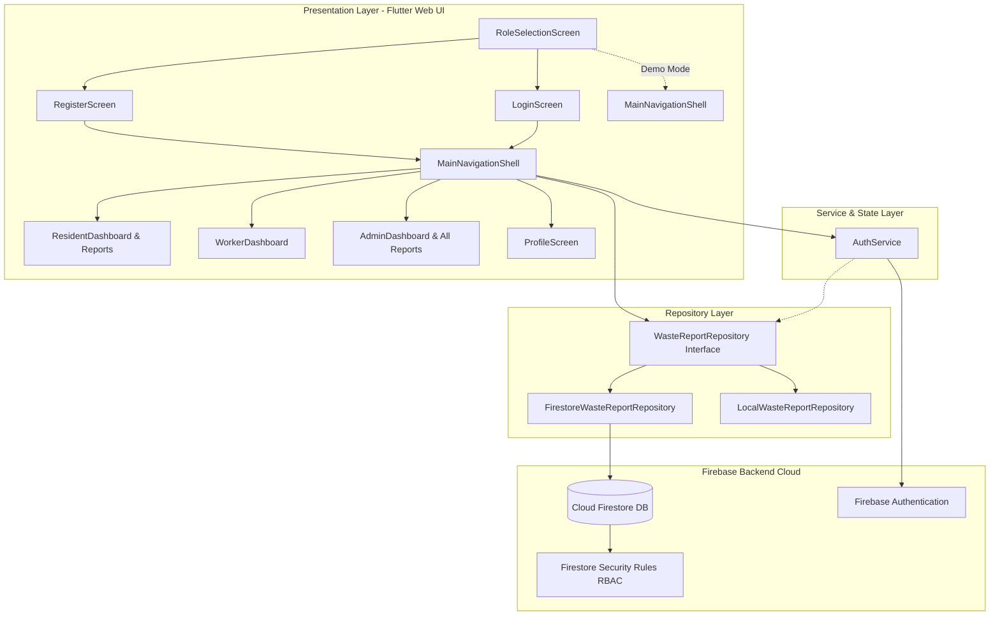

# EcoCollect — Smart Waste Collection Manager
### Sustainable Municipal Waste Management & Citizen Incident Reporting System

[](https://smart-waste-collection-manager.web.app/)
[](https://flutter.dev)
[](https://dart.dev)
[](docs/TESTING.md)
[](docs/TESTING.md)
[](docs/SECURITY.md)
[](docs/PROJECT_REPORT.md)

**Live Application:** [https://smart-waste-collection-manager.web.app](https://smart-waste-collection-manager.web.app/)
**Public Repository:** [https://github.com/sujitha-kotyada/Smart-Waste-Collection-Manager](https://github.com/sujitha-kotyada/Smart-Waste-Collection-Manager)
**Target Evaluation:** College Capstone / Final Year Engineering Demonstration
**SDG Alignment:** UN Sustainable Development Goal 11 (*Sustainable Cities and Communities*) & Goal 12 (*Responsible Consumption and Production*)

---

## 1. Project Overview & Problem Statement
Rapid urbanization and fragmented municipal collection infrastructure frequently cause overflowing public garbage bins, hazardous domestic littering, and unsegregated landfill dumping. Citizens lack transparent reporting channels, while field sanitation workers have no real-time route assignment dispatch system.

**EcoCollect** resolves this urban challenge through a responsive Flutter Web application connected to Firebase Authentication and Cloud Firestore, providing role-based workflows for:
1. **Community Residents:** Report waste incidents with categories, geographic locations, urgency ratings, and descriptions; track cleanup status in real time; access waste segregation education and transparent carbon-offset estimations.
2. **Municipal Field Sanitation Workers:** Access active assigned routes, review task severity, update operational statuses (`Assigned` $\rightarrow$ `In Progress` $\rightarrow$ `Completed`), log field resolution notes, and track daily cleared volumes.
3. **Municipal Administrators / Supervisors:** Real-time city-wide operations console, KPI monitoring (resolution percentage, open emergency queues), field personnel dispatching with dynamic worker rosters, and status overrides.

---

## 2. Technology Stack
- **Framework:** Flutter 3.41.4 (Channel stable)
- **Language:** Dart 3.11.1 (Sound Null Safety)
- **Primary Deployment Platform:** Web (HTML5 CanvasKit / Wasm, responsive desktop/tablet/mobile layouts)
- **Design System:** Material Design 3 with curated Eco-Emerald palette (`#1B5E20`, `#2E7D32`, `#E8F5E9`)
- **Cloud Infrastructure:**
  - **Firebase Core:** `^5.0.0`
  - **Firebase Authentication:** `^7.0.0` (Email/Password registration, login, and session restoration)
  - **Cloud Firestore:** `^7.0.0` (Persistent NoSQL database, structured queries, compound indexes)
  - **Firebase Hosting:** Fast, secure production SSL web hosting
  - **Firebase Security Rules:** Role-Based Access Control (RBAC) preventing unauthorized privilege escalation
- **Testing Toolchain:**
  - `flutter_test` (89 automated unit, model, repository, service, and widget workflow tests)
  - `@firebase/rules-unit-testing ^3.0.0` (39 Firestore emulator security rules unit tests)

---

## 3. System Architecture & Component Flow



---

## 4. Dual Persistence Architecture: Demo Sandbox vs. Cloud Firestore

EcoCollect cleanly isolates live cloud operations from local academic evaluation:

1. **Live Cloud Sync (`FirestoreWasteReportRepository`):**
   - Active for real Firebase-authenticated accounts (`users/{uid}` registered via Firebase Auth).
   - Reads and writes interact directly with Cloud Firestore.
   - Failures (e.g., network disconnects, locked rules, or permissions errors) are **never silently caught or masked**; authentic errors are surfaced directly to the user interface.
2. **Simulated Demo Sandbox (`LocalWasteReportRepository`):**
   - An explicitly chosen, visibly badged in-memory evaluation sandbox accessible via the `RoleSelectionScreen`.
   - Allows evaluators to test Resident, Sanitation Worker, and Municipal Administrator roles without requiring manual user creation in the Firebase Console.
   - Guaranteed zero mutation of live production data.

---

## 5. User Roles & Permission Matrix

| Role | Read Permissions | Create Permissions | Update Permissions | Delete Permissions |
| :--- | :--- | :--- | :--- | :--- |
| **Resident** | Own submitted reports (`streamUserReports`), Eco tips, User profile | Waste reports (default status: `Pending`, unassigned) | Content fields only while status is `Pending` (`wasteCategory`, `location`, `description`, `priority`) | None |
| **Worker** | Assigned tasks (`assignedWorkerId == uid`), Eco tips | None | Status transitions: `Assigned` $\rightarrow$ `In Progress` $\rightarrow$ `Completed` (requires `resolutionNotes`) | None |
| **Admin** | City-wide municipal reports (`streamAllReports`), worker roster, system stats | None (supervises incident queue) | Worker assignment, re-assignment, any status override | Administrative archive / deletion |

### Evaluator Quick-Access Personas
To facilitate academic review without requiring multiple email accounts to be created in the Firebase Console, the system includes instant role-switching personas in both the Role Selection and Profile screens:
- **Resident:** `Sujitha (Resident)` (`sujitha.resident@ecocollect.org`)
- **Sanitation Worker:** `Rajesh Kumar (Electric Truck #04)` (`rajesh.field@ecocollect.org`)
- **Administrator:** `Admin Supervisor` (`admin.manager@ecocollect.org`)

---

## 6. Environmental & SDG Impact (Defensible Metrics)
The application adheres strictly to verifiable, documented calculation benchmarks:
- **UN SDG 11 (Target 11.6):** Reduce urban environmental impact via municipal waste management.
- **UN SDG 12 (Target 12.5):** Substantially reduce waste generation through segregation and diversion.
- **Defensible Benchmark Calculations:**
  - Diverted Waste: $5.2\text{ kg}$ average municipal batch weight per *verified completed* cleanup.
  - Avoided Greenhouse Gases: $0.72\text{ kg CO}_2\text{e}$ avoided per kg diverted from open dumping (EPA Waste Reduction Model benchmark).
  - Rescued Plastics: ~30 single-use containers diverted per completed plastic collection.
  - *Uncollected/pending reports do not claim diverted mass until confirmed cleaned by field crew.*

---

## 7. Local Setup & Execution Guide

### Prerequisites
- **Flutter SDK:** v3.41.4 or compatible (`channel stable`)
- **Dart SDK:** v3.11.1
- **Web Browser:** Google Chrome or Microsoft Edge
- **Firebase CLI:** v13+ (optional, for remote security rules or hosting deployment)

### 1. Install Dependencies
```bash
flutter pub get
```

### 2. Run the Application in Chrome
```bash
flutter run -d chrome
```

### 3. Run Analysis & Automated Test Suite
```bash
# Static code analysis (verified 0 issues)
flutter analyze

# Automated Flutter test suite (89 Unit, Model, Service & Widget tests)
flutter test
```

### 4. Build Production Web Release Bundle
```bash
flutter build web --release
```
The optimized web distribution bundle is generated in `build/web/`.

### 5. Deploy to Firebase Hosting (Optional)
```bash
firebase deploy --only hosting
```

---

## 8. Directory Structure
```
lib/
├── firebase_options.dart               # Generated Firebase web configuration
├── main.dart                           # Entry point, session verification splash, role shells
├── core/
│   ├── constants/app_constants.dart    # Categories, statuses, RBAC transitions
│   ├── theme/app_theme.dart            # Material 3 eco palette, typography
│   └── utils/
│       ├── date_formatter.dart         # Relative and standard date formatting
│       └── impact_calculator.dart      # Defensible SDG 11 & 12 formulas
├── models/
│   ├── app_user.dart                   # User identity, roles & permissions
│   └── waste_report.dart               # Waste report data model & validation
├── repositories/
│   └── waste_report_repository.dart    # Cloud Firestore & isolated Demo repositories
├── services/
│   └── auth_service.dart               # Firebase Auth wrapper, profile verification & demo personas
└── features/
    ├── admin/admin_dashboard.dart      # Municipal operations console & dispatch dialog
    ├── auth/
    │   ├── login_screen.dart           # Authentication & demo quick login
    │   ├── register_screen.dart        # Resident registration form
    │   └── role_selection_screen.dart  # Evaluator role portal & demo sandbox entry
    ├── eco_tips/eco_tips_screen.dart   # Waste segregation & SDG targets guide
    ├── profile/profile_screen.dart     # Role indicators & persona switcher
    ├── resident/
    │   ├── report_detail_sheet.dart    # Tracking timeline & resolution log
    │   ├── report_waste_dialog.dart    # Form validation & incident submission
    │   ├── resident_dashboard.dart     # Greeting, 4 stats cards, SDG summary
    │   └── resident_reports_screen.dart# Search, category filter, sorting, stream routing
    └── worker/worker_dashboard.dart    # Route dispatch, status progress, notes
```

---

## 9. Evaluation & Viva Demonstration Checklist

When demonstrating or evaluating the live project at [https://smart-waste-collection-manager.web.app/](https://smart-waste-collection-manager.web.app/), use this structured walkthrough:

- [ ] **1. Landing & Role Selection:** Open application; verify the `RoleSelectionScreen` presenting Resident, Worker, and Admin access portals alongside Demo Sandbox buttons.
- [ ] **2. Resident Workflow:**
  - Launch Resident portal (or Demo Resident); verify personalized dashboard and 4 KPI cards.
  - Click `Report Waste`; submit an incident with category, location, and priority.
  - Navigate to `My Reports`; verify instant real-time appearance of the submitted report.
  - Test search by landmark, status chips (`Pending`, `In Progress`, `Completed`), and category filters.
  - Open report detail sheet; verify immutable audit timeline.
- [ ] **3. Sanitation Worker Workflow:**
  - Switch to Sanitation Worker persona (`Rajesh Kumar`); verify active assigned collection route.
  - Advance status from `Assigned` to `In Progress`.
  - Advance status to `Completed`; verify mandatory field resolution notes validation.
- [ ] **4. Municipal Administrator Workflow:**
  - Switch to Municipal Administrator persona; inspect city-wide control center and KPI metric cards.
  - Open dispatch dialog on a pending incident; verify dynamic worker selection.
  - Switch to `All Reports` tab; verify city-wide reports from all residents are displayed with live status indicators.
- [ ] **5. Security & Session Integrity:**
  - Refresh browser; verify session restoration with verification indicator without premature logout.
  - Confirm public registration locks role strictly to `resident`.

---

## 10. Documentation Index
- [System Architecture](docs/ARCHITECTURE.md) — Layered Clean Architecture, data flow & persistence isolation
- [Database Schema & Queries](docs/DATABASE_SCHEMA.md) — Cloud Firestore collections, schemas & composite indexes
- [Security & Access Control (RBAC)](docs/SECURITY.md) — Threat model, security rules matrix & admin provisioning
- [Testing Verification & Coverage](docs/TESTING.md) — 89 Flutter tests & 39 Firestore emulator tests breakdown
- [Academic Project Report](docs/PROJECT_REPORT.md) — Formal Capstone report, problem analysis, SDG metrics & results
