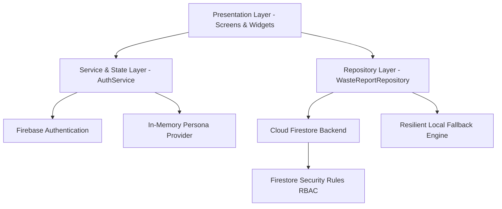

# Architecture Specification — Smart Waste Collection Manager (EcoCollect)

## 1. Architectural Philosophy
EcoCollect utilizes a modular, layered clean architecture designed for cross-platform Flutter applications. It separates business logic from UI widgets, guarantees testability through repository and service abstractions, and integrates securely with Firebase Authentication and Cloud Firestore.

---

## 2. Layer Descriptions

### A. Presentation Layer (`lib/features/`)
Divided strictly by feature domain:
- **`auth/`**: User login, password recovery, resident registration, and fast evaluator role-switching.
- **`resident/`**: Citizen dashboard with 4 KPI summary cards, SDG impact visualization, waste incident reporting modal with form validation, searchable and filterable report directory, and incident detail sheets.
- **`worker/`**: Field crew portal displaying assigned routes, active collections, status advancement triggers (`Assigned` $\rightarrow$ `In Progress` $\rightarrow$ `Completed`), and work completion resolution notes.
- **`admin/`**: Municipal supervisor operations console displaying city-wide metrics, dispatch assignment controls, and status override dialogs.
- **`eco_tips/`**: Community segregation educational guides aligned with UN SDG 11 & 12.
- **`profile/`**: User profile management, infrastructure connectivity indicators, and evaluator persona switching.

### B. Domain & Data Models (`lib/models/`)
- **`WasteReport`**: Immutable domain model containing report metadata (`id`, `reporterId`, `reporterName`, `wasteCategory`, `location`, `description`, `priority`, `status`, `assignedWorkerId`, `assignedWorkerName`, `resolutionNotes`, `createdAt`, `updatedAt`). Includes input validation logic and lifecycle transition checks.
- **`AppUser`**: Represents user identity, email, display name, account creation timestamp, and role flags (`isResident`, `isWorker`, `isAdmin`).

### C. Services & Repositories (`lib/services/` & `lib/repositories/`)
- **`AuthService`**: ChangeNotifier managing authentication states via Firebase Auth, role hydration from Firestore `users` collection, and academic evaluator persona switching. Uses resilient lazy instantiation to operate seamlessly in both live cloud environments and offline/test fixtures.
- **`WasteReportRepository`**: Abstract interface decoupling presentation widgets from storage implementations.
  - `FirestoreWasteReportRepository`: Connects directly to Cloud Firestore `reports` collection with ordered and filtered query streams.
  - `LocalWasteReportRepository`: In-memory reactive stream repository with seed data for offline evaluation and unit tests.
  - The repository seamlessly fails over to the local engine if Cloud Firestore is not yet activated in the cloud console, preventing application crashes.

### D. Design System & Utilities (`lib/core/`)
- **`AppTheme`**: Material 3 theme definitions utilizing an environmental emerald palette (`#1B5E20`, `#2E7D32`), clean neutral backgrounds (`#F7FAF8`), and rounded cards (`16px`).
- **`AppConstants`**: Centralized category definitions, priority levels, status strings, allowed transition matrices, and icon/color mapping helpers.
- **`DateFormatter`**: Standard and relative ("time ago") timestamp formatting without heavy external dependencies.
- **`EnvironmentalImpact`**: Transparent, defensible calculations for kilograms of diverted waste, avoided greenhouse gas emissions ($CO_2e$), and diverted single-use plastics based strictly on verified completed collections.

---

## 3. State Management & Data Flow
1. User actions (e.g. creating a report or transitioning status) trigger methods on the `WasteReportRepository`.
2. The repository updates the underlying persistence store and emits updated collections through broadcast `Stream<List<WasteReport>>`.
3. UI widgets utilize `StreamBuilder` and `ListenableBuilder` to reactively rebuild only the relevant presentation components.
4. Changes made by administrators or workers immediately propagate reactively to resident overview dashboards.
