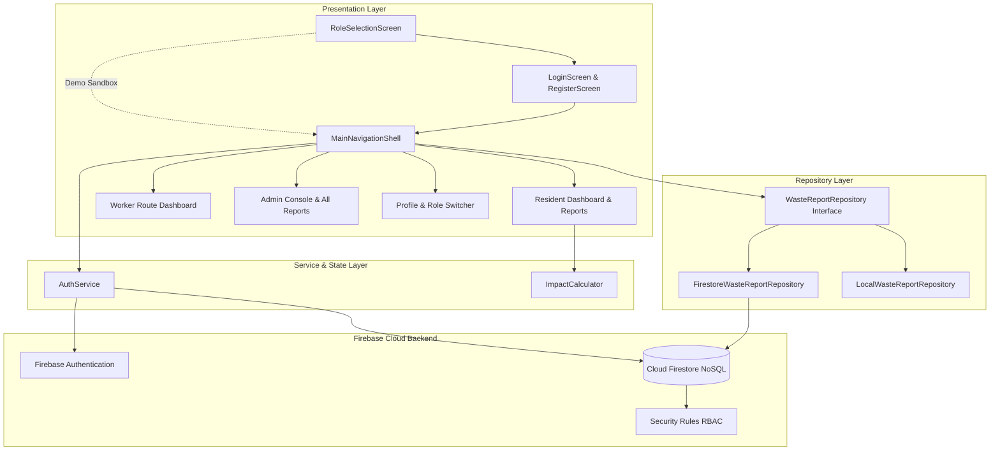
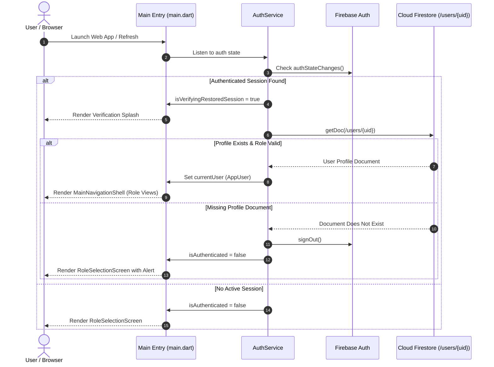

# Architecture Specification — Smart Waste Collection Manager (EcoCollect)

## 1. Architectural Philosophy
EcoCollect utilizes a modular, layered Clean Architecture designed for modern Flutter web applications. It enforces strict separation of concerns:
- **Presentation Layer (`lib/features/`)**: Responsive UI widgets, form validation, and reactive stream builders.
- **Domain & Model Layer (`lib/models/`)**: Immutable data models, entity serialization, and state-transition rules.
- **Service & State Layer (`lib/services/`)**: Authentication state machine, role verification, and session persistence.
- **Repository Layer (`lib/repositories/`)**: Data abstraction interface decoupling UI widgets from persistence mechanisms.
- **Core Layer (`lib/core/`)**: Cross-cutting constants, theme definitions, and defensible environmental impact calculations.



---

## 2. Layer Descriptions & Module Responsibilities

### A. Presentation Layer (`lib/features/`)
Divided strictly by feature domain:
- **`auth/`**:
  - `role_selection_screen.dart`: The unauthenticated landing portal providing dedicated entry points for Residents, Workers, and Administrators, as well as Demo Sandbox launchers.
  - `login_screen.dart`: Authenticates registered users via Firebase Auth and supports demo quick-login.
  - `register_screen.dart`: Public registration for citizens, strictly enforcing the initial `resident` role.
- **`resident/`**:
  - `resident_dashboard.dart`: Displays citizen greetings, 4 personal KPI summary cards, and SDG 11 & 12 impact statistics.
  - `report_waste_dialog.dart`: Incident logging dialog with input validation (category, location, priority, description).
  - `resident_reports_screen.dart`: Citizen incident directory supporting search, category chips, status filtering, and sorting. Subscribes to user-scoped report streams.
  - `report_detail_sheet.dart`: Modal bottom sheet rendering incident history, status progression, and worker resolution notes.
- **`worker/`**:
  - `worker_dashboard.dart`: Operational route console for field sanitation crew. Displays assigned incidents, priority indicators, and status advancement controls. Enforces mandatory resolution notes on completion.
- **`admin/`**:
  - `admin_dashboard.dart`: Municipal control center with city-wide KPI metrics (total volume, pending emergencies, active routes, resolution rate) and unassigned incident dispatch dialog with dynamic worker selection.
- **`eco_tips/`**:
  - `eco_tips_screen.dart`: Community segregation educational guides aligned with UN SDG 11 & 12.
- **`profile/`**:
  - `profile_screen.dart`: User profile management, backend connection status indicators, and evaluator fast-access persona switcher.

---

### B. Domain & Data Models (`lib/models/`)
- **`WasteReport`**: Immutable domain model containing report metadata (`id`, `reporterId`, `reporterName`, `wasteCategory`, `location`, `description`, `priority`, `status`, `assignedWorkerId`, `assignedWorkerName`, `resolutionNotes`, `createdAt`, `updatedAt`). Includes input validation logic and lifecycle transition checks.
- **`AppUser`**: Represents user identity, email, display name, account creation timestamp, and role flags (`isResident`, `isWorker`, `isAdmin`).

---

### C. Services & Repositories (`lib/services/` & `lib/repositories/`)
- **`AuthService`**: `ChangeNotifier` managing authentication state via Firebase Auth, role hydration and verification from Firestore `/users/{uid}`, and academic evaluator persona switching.
- **`WasteReportRepository`**: Decouples presentation widgets from storage implementations:
  - `FirestoreWasteReportRepository`: Connects directly to Cloud Firestore `reports` and `users` collections using structured, ordered query streams.
  - `LocalWasteReportRepository`: In-memory reactive broadcast stream repository with seed data for offline evaluation and unit tests.

---

## 3. Authentication, Session Restoration & Role Verification Flow

When the application boots or the browser is refreshed:
1. `AuthService` listens to `FirebaseAuth.instance.authStateChanges()`.
2. While verifying an existing token, `isVerifyingRestoredSession` is set to `true`, rendering a non-blocking session verification indicator on `main.dart`.
3. If a Firebase user exists:
   - `AuthService` queries `/users/{uid}` in Cloud Firestore to verify the user profile and extract their assigned role string (`resident`, `worker`, or `admin`).
   - If the profile document exists, `currentUser` is populated as an `AppUser`, and `MainNavigationShell` is rendered directly.
   - If the profile document does not exist, authentication is safely aborted with an informative prompt, preventing unverified or orphaned logins.
4. If no Firebase user is authenticated, the user is presented with `RoleSelectionScreen`.



---

## 4. Query Routing & Data Flow

EcoCollect implements distinct, optimized query streams depending on the active user role:

### A. Resident Query: User-Scoped Reports
- **Screen:** `ResidentReportsScreen(showAllReports: false)`
- **Repository Call:** `repository.streamUserReports(user.uid)`
- **Firestore Query:**
  ```dart
  _reportsRef
      .where('reporterId', isEqualTo: uid)
      .orderBy('createdAt', descending: true)
      .snapshots()
  ```
- **Behavior:** Returns only incidents submitted by the logged-in resident. Supported by composite index (`reporterId ASC, createdAt DESC`).

### B. Municipal Administrator Query: City-Wide All Reports
- **Screen:** `ResidentReportsScreen(showAllReports: true)`
- **Repository Call:** `repository.streamAllReports()`
- **Firestore Query:**
  ```dart
  _reportsRef
      .orderBy('createdAt', descending: true)
      .snapshots()
  ```
- **Behavior:** Streams every municipal waste report submitted across the entire city, with live loading indicators and clear error states.

### C. Sanitation Worker Query: Assigned Routes
- **Screen:** `WorkerDashboard`
- **Repository Call:** `repository.streamWorkerReports(user.uid)`
- **Firestore Query:**
  ```dart
  _reportsRef
      .where('assignedWorkerId', isEqualTo: workerId)
      .snapshots()
  ```
- **Behavior:** Filters reports assigned specifically to the field sanitation worker, supporting status progression (`Assigned` $\rightarrow$ `In Progress` $\rightarrow$ `Completed`).

### D. Dynamic Worker Roster Query
- **Trigger:** Admin opens the worker assignment dispatch dialog in `AdminDashboard`.
- **Repository Call:** `repository.getAvailableWorkers()`
- **Firestore Query:**
  ```dart
  _usersRef
      .where('role', isEqualTo: 'worker')
      .get()
  ```
- **Behavior:** Loads real registered worker profiles from Firestore without hardcoding worker names or UIDs.

---

## 5. Strict Persistence Isolation (No Silent Fallbacks)

In earlier iterations, applications often masked backend connectivity failures by falling back to in-memory mocks. **EcoCollect strictly repudiates silent fallbacks:**

1. **Cloud Mode Integrity:** When a user logs in via Firebase Authentication, `FirestoreWasteReportRepository` is engaged. If a read/write operation fails due to network outage, permissions denial, or locked rules, the error is **surfaced honestly to the user interface** via SnackBars or dedicated error screens (`Icons.error_outline`). It **never** silently switches to mock data.
2. **Demo Mode Isolation:** When an evaluator clicks a Demo Sandbox persona on `RoleSelectionScreen`, `LocalWasteReportRepository` is engaged. This in-memory repository is completely isolated from Cloud Firestore, ensuring zero unintended writes to production databases.
