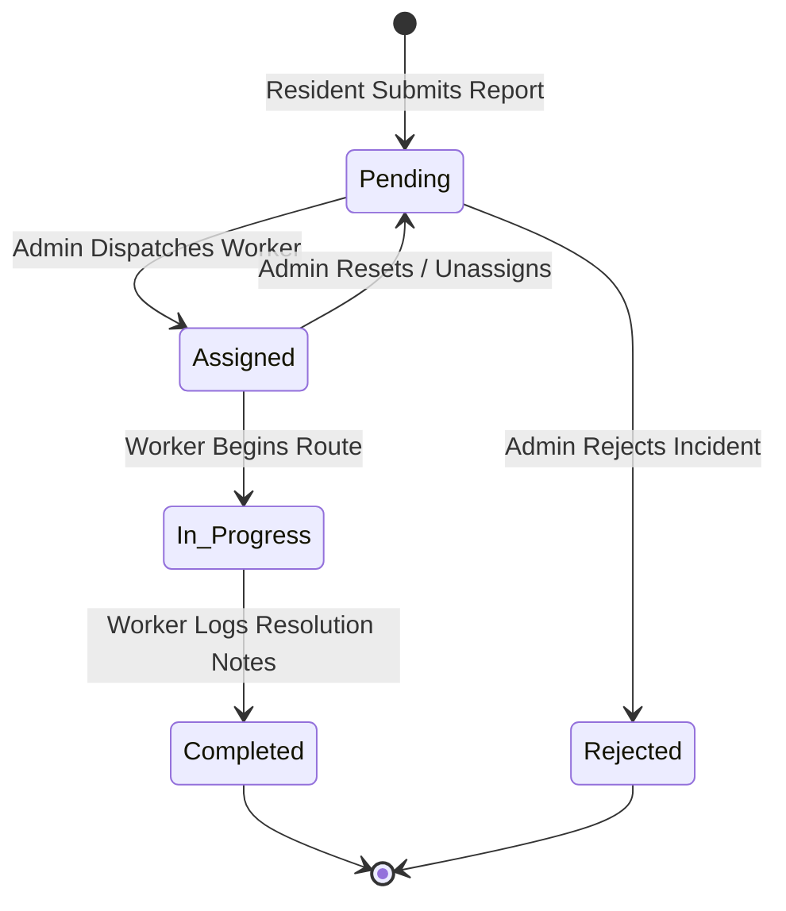

# Database Schema Specification — Cloud Firestore

## 1. Overview
EcoCollect uses Google Cloud Firestore, a scalable NoSQL document database. Data is organized into two primary root-level collections:
1. `users`: Stores user profile data and RBAC authority levels.
2. `reports`: Stores municipal waste incident reports, dispatch states, field resolution notes, and audit timestamps.

---

## 2. Collections Schema

### A. `users` Collection
**Path:** `/users/{userId}`
**Primary Key:** Firebase Auth `uid` (`request.auth.uid`)

| Field | Type | Required | Description | Constraints / Lifecycle Rules |
| :--- | :--- | :---: | :--- | :--- |
| `uid` | `string` | Yes | Unique identifier matching Firebase Auth | Required, immutable across document updates. |
| `email` | `string` | Yes | Registered user email address | Required, valid email format. |
| `displayName` | `string` | Yes | Citizen, worker, or administrator name | Required, minimum length 2 characters. |
| `role` | `string` | Yes | Access tier (`resident`, `worker`, `admin`) | Required. Public registration strictly enforces `resident`. Role changes require admin authority. |
| `createdAt` | `string` / `timestamp` | Yes | Profile registration date (ISO-8601 string) | Required, immutable after creation. |

---

### B. `reports` Collection
**Path:** `/reports/{reportId}`
**Primary Key:** Unique generated alphanumeric string (e.g. `REP-7281902`)

| Field | Type | Required | Description | Constraints / Lifecycle Rules |
| :--- | :--- | :---: | :--- | :--- |
| `id` | `string` | Yes | Unique report identifier | Required, matches `reportId` document key. Immutable. |
| `reporterId` | `string` | Yes | `uid` of submitting citizen | Required, must match `request.auth.uid`. Immutable. |
| `reporterName` | `string` | Yes | Display name of submitting resident | Populated on creation. Immutable. |
| `wasteCategory` | `string` | Yes | Classification category | Must match allowed categories (`Plastic Waste`, `Organic Waste`, `Household Waste`, `Paper & Cardboard`, `E-Waste`, `Hazardous Waste`, `Construction Debris`, `Overflowing Bin`, `Other`). |
| `location` | `string` | Yes | Physical location, sector, or landmark | Required string, minimum length 3 characters. |
| `description` | `string` | Optional | Incident details and context | Optional string. |
| `priority` | `string` | Yes | Urgency rating | Must match allowed priorities (`Low`, `Medium`, `High`, `Urgent`). Defaults to `Medium`. |
| `status` | `string` | Yes | Incident lifecycle status | Allowed: `Pending`, `Assigned`, `In Progress`, `Completed`, `Rejected`. Enforces state-machine rules. |
| `assignedWorkerId` | `string`? | Optional | `uid` of assigned sanitation worker | Null on creation. Populated by Administrator on dispatch. |
| `assignedWorkerName`| `string`? | Optional | Name of assigned sanitation worker | Null on creation. Populated alongside `assignedWorkerId`. |
| `resolutionNotes` | `string`? | Optional | Field cleanup notes logged by worker | Null during `Pending` and `Assigned`. **Mandatory and non-empty** upon transitioning to `Completed`. |
| `createdAt` | `string` / `timestamp` | Yes | Incident submission timestamp | Set on document creation. Strictly immutable. |
| `updatedAt` | `string` / `timestamp` | Yes | Last status or detail modification | Updated on each state transition or content edit. |

---

## 3. Incident Lifecycle & Permitted Transitions

EcoCollect enforces an auditable, deterministic status transition graph:

### Transition Authority Matrix

| Transition | Authorized Roles | Enforced Preconditions |
| :--- | :--- | :--- |
| $\rightarrow$ `Pending` (Create) | Resident | Initial creation only; `reporterId == request.auth.uid`; `assignedWorkerId` and `resolutionNotes` must be null. |
| `Pending` $\rightarrow$ `Assigned` | Administrator | `assignedWorkerId` must be non-empty string referencing valid worker. |
| `Pending` $\rightarrow$ `Rejected` | Administrator | Marks non-actionable or duplicate reports. |
| `Assigned` $\rightarrow$ `In Progress` | Assigned Worker or Administrator | Worker must match `assignedWorkerId`. `resolutionNotes` must remain null. |
| `In Progress` $\rightarrow$ `Completed` | Assigned Worker or Administrator | Worker must match `assignedWorkerId`. `resolutionNotes` is **strictly mandatory** and non-empty. |
| Edit Content | Resident | Permitted only while status is `Pending`. Incident facts become immutable once assigned. |

---

## 4. Configured Composite Indexes & Query Patterns

Configured in [firestore.indexes.json](../firestore.indexes.json) to guarantee sub-second real-time streaming and prevent index-related query exceptions:

### 1. Resident History Index
- **Collection Group:** `reports`
- **Fields:** `reporterId` (ASCENDING), `createdAt` (DESCENDING)
- **Application Query:** `_reportsRef.where('reporterId', isEqualTo: uid).orderBy('createdAt', descending: true)`
- **Purpose:** Serves the Resident "My Reports" tab, ordering the citizen's personal reports newest-first.

### 2. Sanitation Worker Route Index
- **Collection Group:** `reports`
- **Fields:** `assignedWorkerId` (ASCENDING), `status` (ASCENDING)
- **Application Query:** `_reportsRef.where('assignedWorkerId', isEqualTo: workerUid)`
- **Purpose:** Serves the Worker Dashboard, filtering active dispatches assigned to specific field crew personnel.

### 3. Municipal Status Stream Index
- **Collection Group:** `reports`
- **Fields:** `status` (ASCENDING), `createdAt` (DESCENDING)
- **Application Query:** `_reportsRef.where('status', isEqualTo: status).orderBy('createdAt', descending: true)`
- **Purpose:** Powers municipal supervisor queues, enabling administrators to isolate pending emergencies ordered by submission time.
