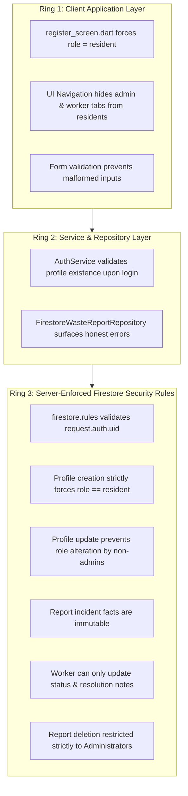

# Security Architecture & Access Control Specification (RBAC)

## 1. Authentication & Identity Management
EcoCollect integrates with Firebase Authentication for primary cryptographic identity verification:
- **Email/Password Authentication:** Validates user credentials with standard password length enforcement ($\ge 6$ characters).
- **Session Tokens:** JSON Web Tokens (JWT) managed securely by the Firebase SDK in browser storage without exposing plaintext credentials.
- **Session Restoration & Verification:** When a session is resumed or the browser is refreshed, `AuthService` verifies token validity with Firebase Auth and performs an out-of-band profile read from Cloud Firestore (`/users/{uid}`) to ensure the user document exists and has a recognized role (`resident`, `worker`, or `admin`).

---

## 2. Threat Model & Defense Against Privilege Escalation

In naive web applications, a public registration form often accepts an arbitrary, client-provided `role` parameter, enabling malicious actors to grant themselves administrative permissions.

**EcoCollect enforces security across multiple defense rings:**



### Server-Enforced vs. Client-Side Controls
- **Client-Side Restrictions:** Provide immediate user feedback and navigation routing. However, client-side checks can be bypassed by malicious HTTP requests.
- **Server-Enforced Rules (`firestore.rules`):** Evaluated atomically within Google Cloud Firestore. Client requests attempting unauthorized reads, writes, status skips, or role escalations fail with `PERMISSION_DENIED`, regardless of client state.

---

## 3. Profile Validation & First-Admin Provisioning

### Public Registration Guard
When a citizen registers at `/users/{userId}`, security rules mandate:
```javascript
allow create: if isAuthenticated() &&
                 isOwner(userId) &&
                 request.resource.data.role == 'resident' &&
                 request.resource.data.uid == userId;
```
Any request attempting to register with `role: 'admin'` or `role: 'worker'` is rejected server-side.

### Trusted Out-of-Band Admin Provisioning
To avoid hardcoded administrative backdoor credentials or self-elevation security holes, initial administrators must be provisioned through an explicit out-of-band process:
1. **Initial Registration:** The supervisor registers as a standard citizen through the application UI or Firebase Console.
2. **Elevated Privilege Grant:** The project owner elevates the user via:
   - **Method A (Firebase Console):** Navigate to **Firestore Database** $\rightarrow$ `users` collection $\rightarrow$ select user document `{userId}` $\rightarrow$ update `role` from `"resident"` to `"admin"`.
   - **Method B (Firebase Admin SDK):** Set trusted custom claims or update the Firestore user profile using the server-side Admin SDK:
     ```javascript
     await admin.auth().setCustomUserClaims(userId, { admin: true, role: 'admin' });
     ```
3. **Operational Continuity:** Once provisioned, administrators have authorized permissions under `firestore.rules` to manage worker assignments and municipal dispatch operations.

---

## 4. Report Lifecycle State Machine Security

Write access to `/reports/{reportId}` is strictly governed by role-based transition policies in `firestore.rules`:

### A. Incident Creation (Residents)
- User must be authenticated (`request.auth != null`).
- Submitter UID must match author (`request.resource.data.reporterId == request.auth.uid`).
- Initial status must be strictly `'Pending'`.
- Submitter **cannot** inject worker assignments (`assignedWorkerId` must be null or omitted).
- Submitter **cannot** inject field resolution notes (`resolutionNotes` must be null or omitted).
- Category, priority, and location minimum length ($\ge 3$ characters) are validated.

### B. Citizen Report Updates (Residents)
- Residents can only update their own reports (`resource.data.reporterId == request.auth.uid`).
- Updates are permitted **only while status is `'Pending'`**. Once an admin dispatches a crew, resident edits are locked.
- Incident identity facts (`id`, `reporterId`, `createdAt`, `status`) are strictly **immutable**.
- Residents can only modify content fields (`wasteCategory`, `location`, `description`, `priority`, `updatedAt`).

### C. Field Sanitation Worker Updates (Workers)
- Worker must be assigned to the incident (`resource.data.assignedWorkerId == request.auth.uid`).
- Incident facts (`id`, `reporterId`, `reporterName`, `wasteCategory`, `location`, `description`, `priority`, `createdAt`, `assignedWorkerId`) are **strictly immutable**.
- Worker update diffs are strictly restricted to `['status', 'resolutionNotes', 'updatedAt']`:
  ```javascript
  request.resource.data.diff(resource.data).affectedKeys().hasOnly(['status', 'resolutionNotes', 'updatedAt'])
  ```
- **Transition 1 (`Assigned` $\rightarrow$ `In Progress`):** Permitted; `resolutionNotes` must remain null.
- **Transition 2 (`In Progress` $\rightarrow$ `Completed`):** Requires non-empty `resolutionNotes` string documenting field cleanup actions.
- **Post-Completion Lock:** Once marked `Completed`, resolution notes cannot be cleared or modified.

### D. Municipal Operations & Deletions (Administrators)
- Administrators have operational authority to assign workers, reassign routes, and override statuses.
- Incident creation timestamp and reporter ID remain immutable.
- Deletion of incident reports is restricted **strictly to Administrators**:
  ```javascript
  allow delete: if isAdmin();
  ```

---

## 5. Security Rules Verification Suite

The security policies authored in `firestore.rules` are backed by an automated test suite containing **39 unit tests** located in [rules_tests/firestore_rules.test.js](../rules_tests/firestore_rules.test.js) executed via `@firebase/rules-unit-testing`.

### Tested Security Scenarios
1. **Self-Elevation Prevention:** Residents attempting to update their own `role` to `admin` or `worker` fail closed.
2. **Immutable Field Protection:** Attempts to alter `uid`, `reporterId`, or `createdAt` fail closed.
3. **Worker Transition Boundaries:** Workers attempting to edit incident descriptions, priorities, or locations fail closed.
4. **Resolution Note Constraints:** Advancing to `Completed` without resolution notes fails closed; introducing notes during `Assigned` $\rightarrow$ `In Progress` fails closed.
5. **Cross-Worker Isolation:** Workers attempting to update tasks assigned to other personnel fail closed.
6. **Claim & Role Matrix Conflicts:** Evaluates combinations of custom claims (`admin: true`, `worker: true`) versus profile documents to ensure conflicting credentials fail closed.
7. **Worker Roster Privacy:** Non-administrators attempting to query the `users` collection for worker rosters are rejected.

---

## 6. Secrets Management & Code Hygiene
- **Zero Committed Private Keys:** Scanned repository confirms no `.env`, `*credentials*.json`, service-account JSON, `.pem`, or `.key` files are tracked by Git.
- **Client Configuration Safety:** `lib/firebase_options.dart` contains only public FlutterFire Web parameters (`apiKey`, `appId`, `projectId`), which are designed for client-side inclusion and protected by domain whitelisting and Firestore rules.
- **`.gitignore` Hardening:** Excludes build directories, IDE metadata, debug logs (`*-debug.log`), and Node modules.
